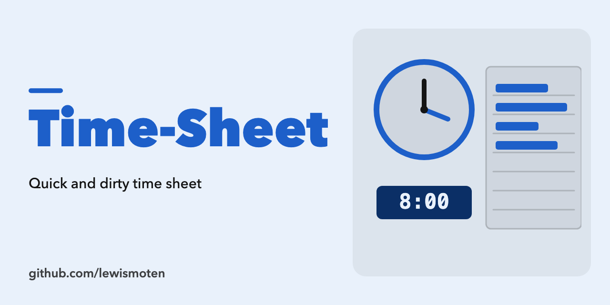

# Time Sheet

A quick and dirty local time sheet. It runs in the browser from plain HTML, CSS and JavaScript, with no build step.

- Keeps clients, sheets and time entries in the browser's localStorage.
- Imports and exports your data as JSON.
- Optionally syncs with a server you provide: it reads and writes the same JSON over a URL you configure (PUT or POST, with an optional bearer token). The server must allow CORS if it is on another origin.

## Use

Open `index.html` in a browser, or serve the folder with any static web server.

## License

ISC. See [LICENSE.md](LICENSE.md).
